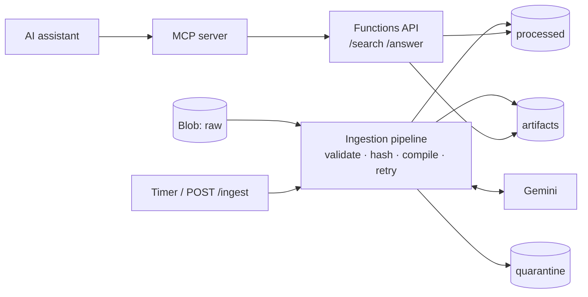

# LLM-Powered Personal Knowledge Base

INDENG 231 — Data Modeling, UC Berkeley, Spring 2026

---

## Overview

This project implements a Karpathy-style personal knowledge base using the Google Gemini API. The system demonstrates what an LLM compiler adds over a simple document store: it reads all raw source material simultaneously, resolves contradictions between sources, and surfaces cross-source implications that no single note contains on its own.

The topic is the design of an AI-powered social platform for shared human experiences — a platform that connects users who have navigated similar life challenges (illness, grief, career disruption, immigration) on a mentor-mentee model, mediated by a voice-enabled AI conversational interface.

---

## How It Works

The pipeline has three layers:

**Layer 1 — Raw notes**

Ten informal research notes covering the five main technical areas of the platform: shared experience platform design, mentor-mentee matching algorithms, affective computing, voice dialogue systems, and empathetic AI design. The notes are written informally with deliberate gaps, redundancy, and contradictions between files to give the compiler real synthesis work.

**Layer 2 — LLM compiler**

`compile_wiki.py` reads all ten notes in a single context window using Gemini 2.5 Flash and generates ten structured wiki articles. The compiler prompt explicitly instructs the model to synthesize across multiple sources (not summarize one), resolve contradictions, and surface implications that only emerge from reading sources together. Each article follows a consistent structure: Key Concepts, How It Works, Design Implications, Open Questions, and See Also with `[[WikiLink]]` cross-references. The compiler produced 6,085 words across ten articles with 90 WikiLinks.

**Layer 3 — Retrieval-augmented Q&A**

`qa.py` uses local embeddings (`all-MiniLM-L6-v2`, run through `fastembed`/ONNX) for cosine similarity retrieval, then Gemini 2.5 Flash to generate cited answers from the top-4 retrieved articles. The embedding approach handles semantic queries that keyword matching would miss — for example, "how does the system detect sadness or distress?" retrieves `AffectiveComputing` at 0.567 cosine similarity despite zero keyword overlap. Embeddings are cached locally so retrieval runs with no API calls.

The entire pipeline runs at zero cost: Gemini 2.5 Flash on the free tier for compilation and Q&A, local embeddings for retrieval. The Azure extension below runs entirely on local emulators, so it also costs nothing.

---

## Project Structure

```
.
├── raw/
│   ├── 01_shared_experience_platforms.md
│   ├── 02_mentor_mentee_matching.md
│   ├── 03_affective_computing.md
│   ├── 04_speech_to_text_pipelines.md
│   ├── 05_text_to_speech_synthesis.md
│   ├── 06_dialogue_systems.md
│   ├── 07_empathetic_ai_design.md
│   ├── 08_experience_storage_retrieval.md
│   ├── 09_platform_integration_architecture.md
│   └── 10_llm_knowledge_base_design.md
│
├── wiki/
│   ├── AffectiveComputing.md
│   ├── DialogueSystem.md
│   ├── EmpathyDesign.md
│   ├── ExperienceMatching.md
│   ├── ExperienceStorageRetrieval.md
│   ├── KnowledgeBaseDesign.md
│   ├── MentorMenteeSystem.md
│   ├── PlatformArchitecture.md
│   ├── SafetyAndEscalation.md
│   ├── VoiceInterface.md
│   ├── _index.json             link graph and word counts
│   └── _embeddings.npy         cached embeddings (generated)
│
├── kb/                         core package: storage, pipeline, retrieval, answer, api, service
├── function_app.py             Azure Functions app (HTTP API + timer)
├── mcp_server.py               MCP server (stdio)
├── tests/                      pytest suite
├── docs/                       architecture, security model, deployment reference
├── compile_wiki.py             LLM compiler (CLI)
├── qa.py                       Q&A interface
├── build_index.py              rebuild _index.json without API calls
├── test_pipeline.py            legacy setup check (superseded by tests/)
├── generate_report2.py         PDF report generator
└── INDENG231_Project2_Report.pdf
```

---

## Setup

**1. Install dependencies**
```bash
python3 -m venv .venv && source .venv/bin/activate
pip install -r requirements-dev.txt
```

**2. Get a free Google API key** at aistudio.google.com (no credit card required). Go to Get API key → Create API key.

**3. Create a `.env` file in the project root**
```
GOOGLE_API_KEY=your-key-here
```

**4. Verify everything is working**
```bash
pytest            # offline tests (Gemini mocked); Azurite tests auto-skip if the emulator is down
```

---

## Usage

**Compile the wiki** (run once, takes 5-10 minutes on the free tier)
```bash
python compile_wiki.py                              # compile all 10 articles
python compile_wiki.py --force                      # recompile everything
python compile_wiki.py --topic AffectiveComputing   # single article
python compile_wiki.py --dry-run                    # preview without API calls
```

**Ask questions**
```bash
python qa.py -q "How does the platform detect when a user is in crisis?"
python qa.py -q "What is the latency budget for voice interaction?"
python qa.py -q "How does mentor burnout get prevented?"
python qa.py                   # interactive mode
python qa.py --list            # list all articles with word and link counts
python qa.py --index           # rebuild embedding index
```

---

## Azure extension (local, emulator-based)

The original CLI still works unchanged. On top of it, the project now has a cloud-style architecture built with
Azure Blob Storage, Azure Functions and an MCP server. **Everything was built and tested locally** against the
Azurite storage emulator and the Azure Functions Core Tools host; **nothing is deployed to Azure.**
See [docs/ARCHITECTURE.md](docs/ARCHITECTURE.md), [docs/SECURITY.md](docs/SECURITY.md) and
[docs/DEPLOYMENT.md](docs/DEPLOYMENT.md) (an unexecuted reference).



**What is implemented**
- **Blob Storage layer** (`kb/storage.py`): one interface, local-folder and Azure Blob backends; SHA-256 stored on upload and verified on download; Azurite-backed contract tests.
- **Incremental ingestion pipeline** (`kb/pipeline.py`): validates inputs (bad files are quarantined), skips work when the corpus hash is unchanged (idempotent; no Gemini calls on re-run), retries transient errors with backoff, isolates per-article failures and resumes from a manifest.
- **Azure Functions REST API** (`function_app.py`): `GET /api/health`, `GET /api/articles`, `POST /api/search`, `POST /api/answer`, `POST /api/ingest`, plus a daily timer trigger. JSON validation, structured error responses with request IDs, function-key auth on all but `/health`.
- **MCP server** (`mcp_server.py`): read-only tools `search_documents`, `answer_question`, `list_articles`, tested with the official MCP Python client over stdio.
- **Structured JSON logging** designed for Application Insights queries (Application Insights itself is **not** connected).

**Not implemented:** Azure deployment, Application Insights/alerts, Azure Data Factory (rationale in the architecture doc), Entra ID auth (documented upgrade path), Key Vault.

**Run it locally**
```bash
npx --yes azurite --location .azurite --silent &
export KB_STORAGE_BACKEND=azure AZURE_STORAGE_CONNECTION_STRING=UseDevelopmentStorage=true
python -m kb.cli upload-raw && python -m kb.cli run     # needs GOOGLE_API_KEY
func start                                              # API on http://localhost:7071/api
curl -X POST localhost:7071/api/search -d '{"query":"how is distress detected?"}'
```
MCP client config (e.g. Claude Desktop `mcpServers`): `{"command": "python", "args": ["mcp_server.py"], "env": {"KB_API_URL": "http://localhost:7071/api"}}`
(only the Python MCP client has been tested; Claude Desktop has not).

**Measured results (local machine, Azurite, 10 articles)**
- 102 automated tests pass (90 need nothing; 12 run against the real Azurite emulator and skip automatically if it is not running).
- `POST /api/search`, warm, 50 requests: median 39 ms, p95 45 ms (excludes Gemini; local, not a production benchmark).
- First full ingestion with real Gemini 2.5 Flash: 10 articles compiled in 66 s, 0 failures (731–905 words each).
- Re-running ingestion on unchanged notes: 10 of 10 articles skipped in 0.12 s with no Gemini calls (idempotent).
- Live `/api/answer` and the MCP `answer_question` tool returned cited answers from the compiled wiki (single manual runs; quality was spot-checked, not formally evaluated).

---

## Wiki Statistics

| Article | Words | Links Out | Links In |
|---|---|---|---|
| AffectiveComputing | 719 | 16 | 8 |
| DialogueSystem | 703 | 14 | 7 |
| EmpathyDesign | 946 | 10 | 7 |
| ExperienceMatching | 895 | 12 | 5 |
| ExperienceStorageRetrieval | 409 | 6 | 8 |
| KnowledgeBaseDesign | 531 | 10 | 0 |
| MentorMenteeSystem | 916 | 12 | 6 |
| PlatformArchitecture | 669 | 12 | 4 |
| SafetyAndEscalation | 678 | 6 | 2 |
| VoiceInterface | 818 | 15 | 6 |

Total: 6,085 words, 90 WikiLinks across 10 articles.
