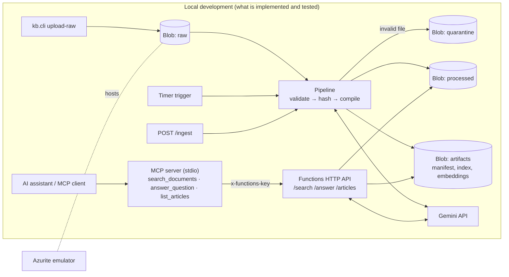

# Architecture

All blob containers run on the **Azurite** emulator; the Functions app runs on the local Core Tools host.
Nothing is deployed to Azure.

## Data flow
1. `upload-raw` copies `raw/*.md` into the `raw` container, skipping files whose SHA-256 already matches.
2. The pipeline downloads each raw note (checksum verified), validates it (non-empty, UTF-8, ≤ 500 KB, no NULs)
   and quarantines failures with a `.reason.txt`.
3. A corpus hash over (name, content-hash) of valid notes is compared with each article's recorded hash.
   Unchanged → zero Gemini calls. Changed → recompile. Progress is saved after every article, so a crash resumes.
4. Transient Gemini errors (429/5xx) retry with exponential backoff; a topic that still fails is reported
   and the others continue (`207` from `/ingest`, non-zero exit from the CLI).
5. When anything changed, `index.json` and `embeddings.npy` are republished to `artifacts`.
6. The API reloads articles only when a checksum changes, and uses stored embeddings only if they were built
   from exactly the current article versions.

## Why "incremental" is corpus-level
Each wiki article is synthesized from *all* raw notes, so editing one note can change any article. Per-article
incrementality would be wrong; skipping when the whole corpus is unchanged is correct and is what is implemented.

## Decision record: Azure Data Factory
**Not used.** The work is Python and LLM calls, which Functions already schedule (timer), trigger (HTTP) and retry.
ADF would only be a scheduler invoking a Function through an Azure Function activity. It would add value for
copying data from many external sources, a run-history UI, or tumbling-window backfills; this project has none of
those needs. Revisit if ingestion grows to multiple external sources.

## Other deliberate omissions
Azure OpenAI (Gemini retained), AI Search / SQL / Data Explorer (10 articles don't need them), Key Vault
(app settings suffice for a demo; see SECURITY.md).
